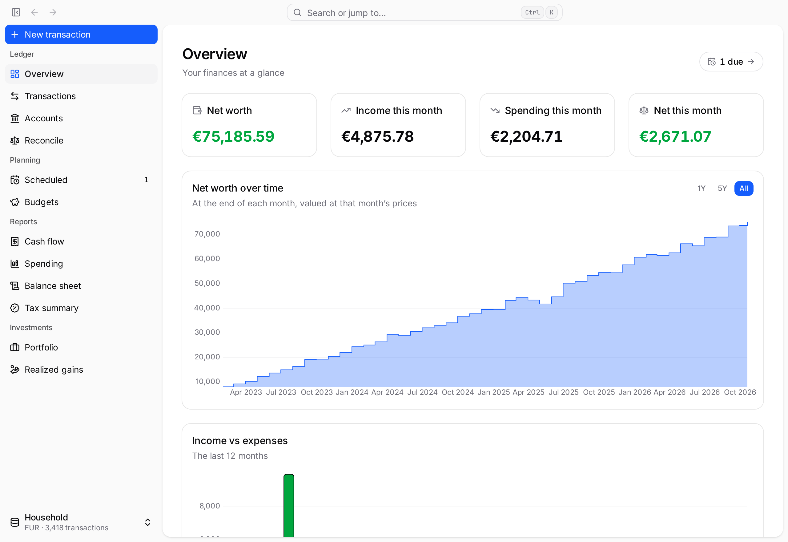
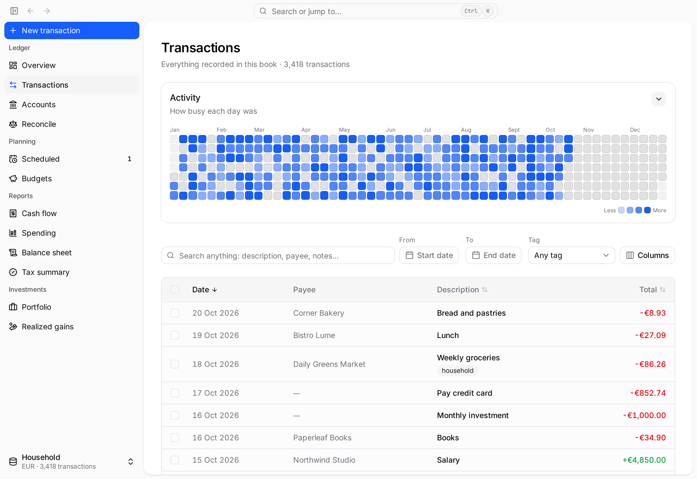
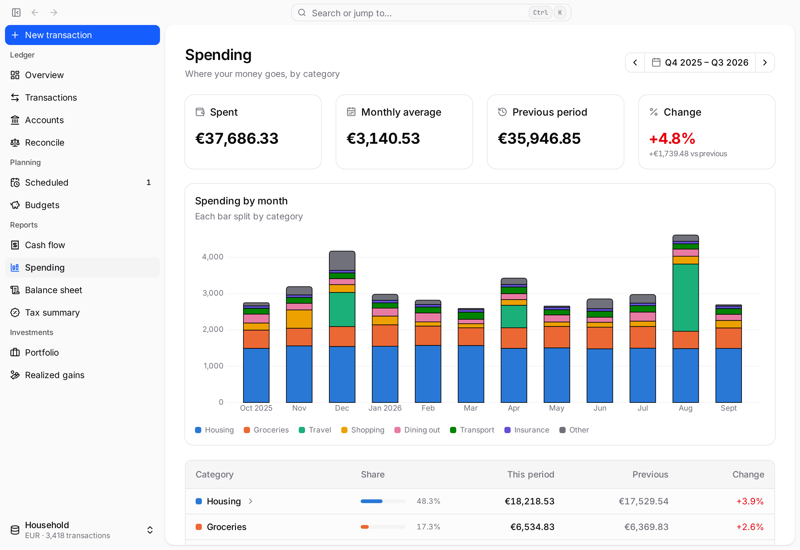
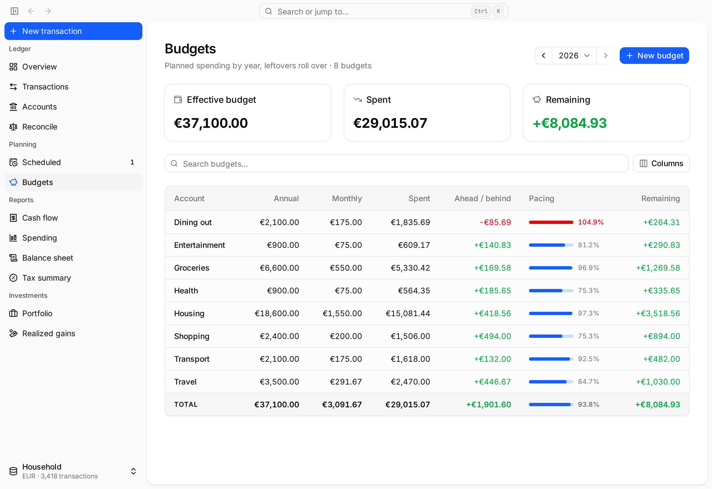
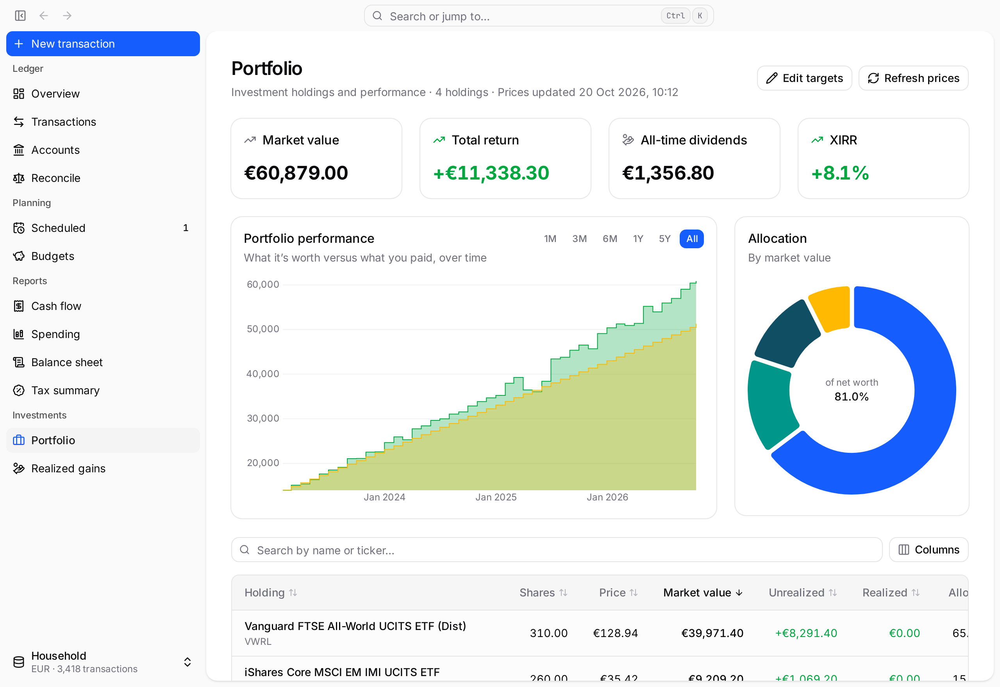

# Spendo

[lewisflames.github.io/spendo](https://lewisflames.github.io/spendo)

A local-first personal finance app for macOS and Linux. Your money lives in a single `.spendo` file on your own disk: no account, no cloud.

- Accounts, transactions and split entries
- Yearly budgets, profit and loss, and a balance sheet
- Investment portfolio with prices from Yahoo Finance
- Statement reconciliation and scheduled transactions
- Import from GnuCash (`.gnucash` SQLite files) or bank CSV statements
- Automatic daily backups, plus a safety snapshot before every import or reset

<picture>
  <source media="(prefers-color-scheme: dark)" srcset="docs/screenshots/overview-dark.png">
  
</picture>

## Screenshots

These show a made-up demo book (`bun run screenshots` regenerates them).

<table>
  <tr>
    <td><picture>
      <source media="(prefers-color-scheme: dark)" srcset="docs/screenshots/transactions-dark.png">
      
    </picture></td>
    <td><picture>
      <source media="(prefers-color-scheme: dark)" srcset="docs/screenshots/spending-dark.png">
      
    </picture></td>
  </tr>
  <tr>
    <td><picture>
      <source media="(prefers-color-scheme: dark)" srcset="docs/screenshots/budgets-dark.png">
      
    </picture></td>
    <td><picture>
      <source media="(prefers-color-scheme: dark)" srcset="docs/screenshots/portfolio-dark.png">
      
    </picture></td>
  </tr>
</table>

## Install

**macOS:** download `Spendo_<version>_universal.dmg` from the [latest release](https://github.com/lewisflames/spendo/releases/latest). The app is not notarized, so on first launch right-click it and choose **Open**. It updates itself from **About → Updates**.

**Linux:** download `Spendo_<version>_amd64.AppImage` from the [latest release](https://github.com/lewisflames/spendo/releases/latest), make it executable and run it. Like the Mac app, it updates itself.

```sh
chmod +x Spendo_*_amd64.AppImage && ./Spendo_*_amd64.AppImage
```

**Arch Linux:** install [`spendo-bin`](https://aur.archlinux.org/packages/spendo-bin) from the AUR (`yay -S spendo-bin`) and update it with your AUR helper.

## Getting started

1. Create a new book or open an existing `.spendo` file from the welcome screen.
2. Optionally bring in your history from GnuCash or a bank CSV via the book menu (or `Ctrl+K`).
3. Changes are saved as you go. Use **Save as…** in the book menu for a backup copy.

## Development

You need [Bun](https://bun.sh), [Rust](https://rustup.rs) and the [Tauri prerequisites](https://v2.tauri.app/start/prerequisites/).

```sh
bun install
bun run tauri:dev    # run the app
bun run check && bun run lint && bun run test
bun run screenshots  # regenerate docs/screenshots from the demo book
```

The frontend is SvelteKit with Tailwind; the backend is Rust over SQLite. See [AGENTS.md](AGENTS.md) for architecture and conventions, and [docs/releasing.md](docs/releasing.md) for cutting a release. The landing page lives in `site/` and deploys to GitHub Pages.

## License

MIT. See [LICENSE.md](LICENSE.md).
